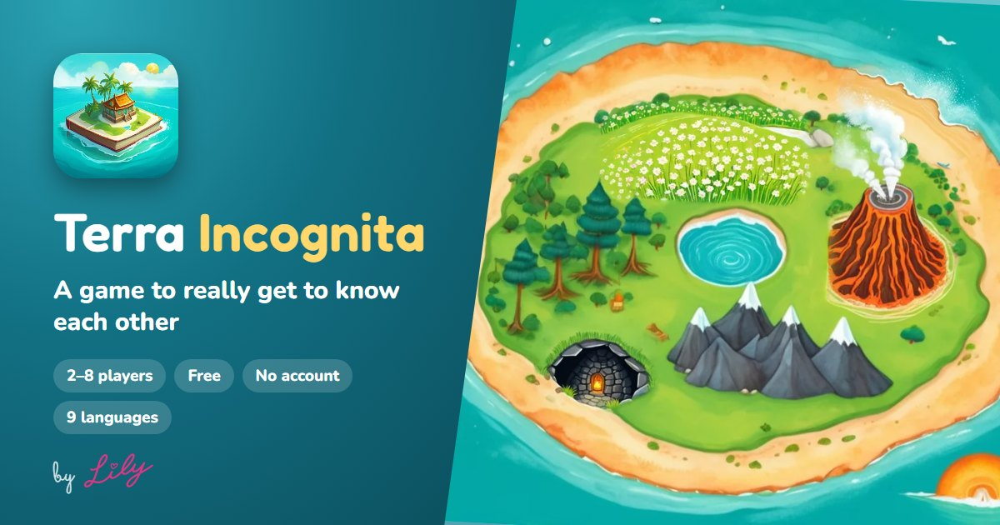

<p align="center">
  <a href="https://lilynovinski.github.io/terra-incognita/"></a>
</p>

<h1 align="center">Terra Incognita</h1>

<p align="center"><b>A free online game to really get to know each other.</b><br>
2 to 8 players · couples, friends, dates, new people · no account · no ads · 9 languages</p>

<p align="center"><a href="https://lilynovinski.github.io/terra-incognita/"><b>▶ Play now</b></a></p>

---

## The idea

Everyone is an island in the mist. During the game, each person draws the map of the others.

You explore someone's island one area at a time, from the shore (first impressions) down to the caves (fears and fragility). The person answers in secret and the others try to guess:

- **Spot on:** the area is drawn in ink on your map.
- **Surprise:** what you didn't know becomes a new place, and its owner names it.

At the end, you swap maps and see your own island as the others see it.

There are no points and nobody loses. The goal is simply to discover each other, at your own pace.

## Why it's different

- **Every rule means something.** You can't guess someone's past, so in the forest you only listen. You can't predict a fear, so in the caves nobody guesses. You reach the horizon (dreams) only from a summit (values).
- **You can always say no.** Any question can stay behind a closed door, and only you can reopen it.
- **The group goes at the gentlest pace.** Everyone votes on the "weather" (how deep you go tonight), and the calmest choice wins.
- **Maps are kept and slowly fade.** Play again weeks later: old areas grow faint, because people change.
- **Message in a bottle.** Once per game, write your own question.
- **Made for any relationship.** A couple, a first date, old friends, a new group: no labels needed.

## How to play

1. Open the game, enter your name, pick a colour and **create a game**.
2. Share the 4-letter code (or the invite link) with the others.
3. Everyone votes on tonight's weather; the host launches the expedition.
4. Take turns exploring each other's islands. Talk out loud, on a call or around a table.

It works on phones and computers, in any modern browser. Nothing to install.

## Privacy

The game is peer-to-peer (WebRTC via [PeerJS](https://peerjs.com/)). There is no account and no game server storing your answers: the host's browser runs the game, and the maps are saved only in each player's own browser.

## Languages

Each player can choose their own language, even within the same game.

| | |
|---|---|
| 🇫🇷 **Français** | Un jeu en ligne gratuit pour apprendre à se connaître, de 2 à 8 personnes. Chacun est une île dans la brume : on dessine la carte des autres en devinant, en écoutant et en racontant. |
| 🇬🇧 **English** | A free online game to get to know each other, for 2 to 8 players. Everyone is an island in the mist: draw each other's maps by guessing, listening and telling. |
| 🇪🇸 **Español** | Un juego online gratuito para conocerse, de 2 a 8 personas. Cada persona es una isla en la bruma: dibujad el mapa de los demás adivinando, escuchando y contando. |
| 🇮🇹 **Italiano** | Un gioco online gratuito per conoscersi, da 2 a 8 persone. Ognuno è un'isola nella nebbia: disegnate la mappa degli altri indovinando, ascoltando e raccontando. |
| 🇩🇪 **Deutsch** | Ein kostenloses Online-Spiel zum Kennenlernen für 2 bis 8 Personen. Jeder Mensch ist eine Insel im Nebel: Zeichnet die Karten der anderen, indem ihr ratet, zuhört und erzählt. |
| 🇷🇺 **Русский** | Бесплатная онлайн-игра, чтобы узнать друг друга, от 2 до 8 человек. Каждый — остров в тумане: рисуйте карты друг друга, угадывая, слушая и рассказывая. |
| 🇨🇳 **中文** | 一款免费的在线相识游戏，适合 2 到 8 人。每个人都是雾中的一座岛：通过猜测、倾听和讲述，绘制彼此的地图。 |
| 🇮🇱 **עברית** | משחק אונליין חינמי להיכרות, ל-2 עד 8 אנשים. כל אדם הוא אי בערפל: משרטטים את המפות זה של זה דרך ניחוש, הקשבה וסיפור. |
| 🇧🇷 **Português** | Um jogo online grátis para se conhecer, de 2 a 8 pessoas. Cada pessoa é uma ilha na névoa: desenhem o mapa uns dos outros adivinhando, escutando e contando. |

Direct links: [fr](https://lilynovinski.github.io/terra-incognita/?lang=fr) · [en](https://lilynovinski.github.io/terra-incognita/?lang=en) · [es](https://lilynovinski.github.io/terra-incognita/?lang=es) · [it](https://lilynovinski.github.io/terra-incognita/?lang=it) · [de](https://lilynovinski.github.io/terra-incognita/?lang=de) · [ru](https://lilynovinski.github.io/terra-incognita/?lang=ru) · [zh](https://lilynovinski.github.io/terra-incognita/?lang=zh) · [he](https://lilynovinski.github.io/terra-incognita/?lang=he) · [pt](https://lilynovinski.github.io/terra-incognita/?lang=pt)

## Run it yourself

It's a static site: `index.html` plus `i18n.js`. Serve the folder with any web server, for example:

```bash
python -m http.server 8000
```

Then open http://localhost:8000.

## Credits

The built-in spell checker (`spell.js`, word lists in `spell/`) uses word frequency lists from [FrequencyWords](https://github.com/hermitdave/FrequencyWords) by Hermit Dave, built from OpenSubtitles 2018, licensed [CC BY-SA 4.0](https://creativecommons.org/licenses/by-sa/4.0/). The lists in `spell/` are filtered and re-encoded versions of them, under the same licence.

---

<p align="center">Made with care by Lily ♥ · free, for anyone who wants a good game</p>
